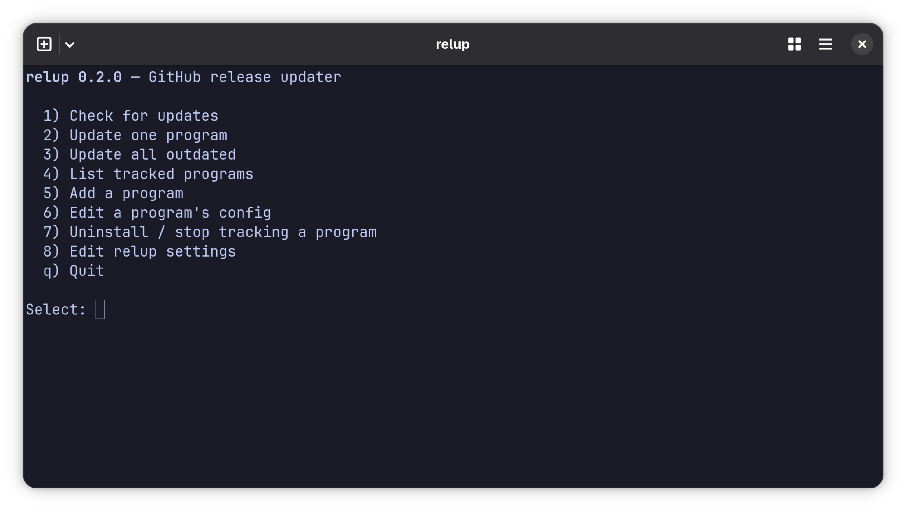
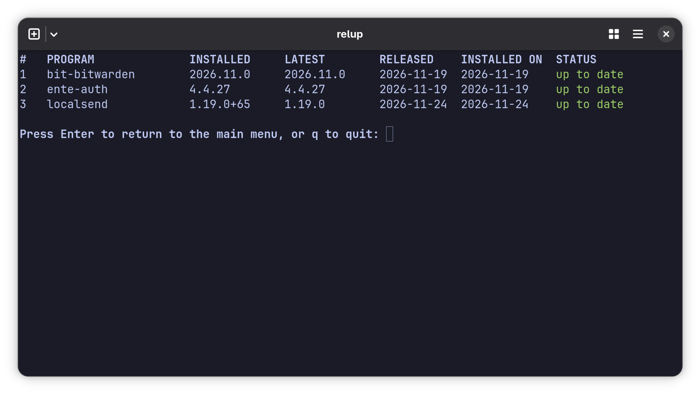

# relup

*Update programs installed from GitHub releases, one at a time or all at once.*

An interactive Bash tool that keeps programs you installed by hand up to date, straight from their GitHub releases.

If you download `.rpm` packages from GitHub release pages instead of using a package repository, `relup` remembers where each one came from, tells you when a newer release exists, and updates one program or all of them in a single step.

> **Status:** early development (v0.2.1). It currently installs **`.rpm` packages via `dnf`** (Fedora, RHEL and relatives). Other install types and sources are planned, see the [roadmap](#roadmap).

## Features

- **Guided setup with almost no typing.** Paste a GitHub URL, type `owner/repo`, or enter a username to browse their repositories. `relup` works out the file pattern, the display name and the package name by itself, detects whether the program is already installed, and asks for one confirmation before saving.
- **Update one or all.** Interactive menu or plain commands. The menu stays at the top of a cleared screen, and after each job you choose between returning to it or quitting.
- **Dates.** Shows each release's date and when each program was installed or last upgraded.
- **Checksum verification** before anything is installed (see [Checksums](#checksums)).
- **Works with shared repositories** that publish several products (for example `desktop-v…` and `web-v…` tags in the same repo).
- **Plain-text config**: one small file per program, easy to read and edit.
- **No code in config files.** They are parsed as data and never executed.

## Requirements

- Bash 4.4 or newer
- `curl`, `jq` and `sha256sum`
- `rpm` and `dnf` with `sudo` access (for the current install method)

On Fedora: `sudo dnf install curl jq` (the rest is normally already present).

## Install

```bash
git clone https://github.com/atom1cpunk/relup.git
cd relup
install -m 755 relup ~/.local/bin/relup     # make sure ~/.local/bin is in your PATH
```

## Quick start

```bash
relup
```

On first run, `relup` offers to add your first program. For example, enter:

```
https://github.com/brave/brave-browser/releases
```

You then pick a release, your CPU architecture and (only if the release has several) the file to track. `relup` reads the package name from the file's header, checks whether you already have the program installed, shows a short summary and asks once before saving. If the program isn't installed yet, it offers to install it.

Once you are tracking programs, running `relup` opens the main menu:

<p align="center">
  
</p>

After each job, `relup` waits so you can read the output, then lets you return to the menu (Enter) or quit (`q`).

## Commands

| Command | What it does |
|---|---|
| `relup` | Open the interactive menu |
| `relup add [URL\|owner/repo]` | Start tracking a program (guided) |
| `relup list` | List tracked programs, installed versions and install dates (works offline) |
| `relup check` | Compare installed vs. latest version (with release and install dates) for every program |
| `relup update <id>` | Update one program |
| `relup update --all` | Update every program that has a newer release |
| `relup edit <id>` | Edit a program's config in `$VISUAL` / `$EDITOR` |
| `relup remove <id>` | Uninstall a program and/or stop tracking it |
| `relup config` | Edit `relup`'s own settings |
| `relup --help`, `relup --version` | Help and version |

Add `-y` / `--yes` to answer yes to ordinary confirmation prompts. Uninstalling, replacing a config and installing a download that has no published checksum always ask, even with `-y`. For a program you trust that publishes no checksum, set `VERIFY_CHECKSUM='skip'` in its config to update it unattended.

### Checking for updates

`relup check` (or option 1 in the menu) compares what you have installed with the latest release of every tracked program:

<p align="center">
  
</p>

- **RELEASED** is the date the latest release was published on GitHub.
- **INSTALLED ON** is when the package was installed or last upgraded.
- Build suffixes are ignored when comparing, so `1.19.0+65` installed counts as up to date against a `1.19.0` release (as with `localsend` above).

## Configuration

Files live in `~/.config/relup/` (or `$XDG_CONFIG_HOME/relup/`):

```
~/.config/relup/
├── settings.conf        relup's own settings
└── apps.d/
    ├── brave-browser.conf
    └── enteauth.conf    one file per tracked program
```

### Program config

`relup add` writes these for you, but you can edit them by hand (`relup edit <id>`):

```ini
NAME='Ente Auth'
SOURCE='github'
REPO='ente-io/ente'
TAG_PREFIX='auth-v'
ASSET_REGEX='(x86_64|amd64).*\.rpm$'
INSTALL='rpm'
PKG='enteauth'
VERIFY_CHECKSUM='auto'
```

| Key | Meaning |
|---|---|
| `NAME` | Display name used in tables and messages. Filled in automatically; change it freely. |
| `SOURCE` | Where releases come from (`github` only, for now) |
| `REPO` | GitHub `owner/repo` |
| `TAG_PREFIX` | Only releases whose tag starts with this are considered. Separates products in shared repos (`auth-v`, `desktop-v`). May be empty. |
| `ASSET_REGEX` | Regular expression the release file name must match |
| `INSTALL` | How the file is installed (`rpm` for now) |
| `PKG` | Package name as known to `rpm` (check with `rpm -q <name>`). It can differ from the release file's name (e.g. `LocalSend-….rpm` contains the package `localsend_app`); `relup` checks the downloaded file and offers to correct it. |
| `VERIFY_CHECKSUM` | `auto`, `required` or `skip` (see below) |

Rules: one `KEY='value'` per line, `#` comments on their own line, no inline comments.

### Settings

| Key | Meaning | Default |
|---|---|---|
| `DOWNLOAD_DIR` | Where downloads are staged before installing. A temporary subfolder is created and removed afterwards. | `/tmp` |
| `CLEAR_SCREEN` | `yes` or `no`. Clear the screen before each menu and job. Set to `no` to keep earlier output on screen. | `yes` |

## How a release is chosen

For each program, `relup` reads the repository's recent releases, up to 300 (skipping drafts and prereleases), keeps those whose tag starts with `TAG_PREFIX`, and takes the newest one that has a file matching `ASSET_REGEX`. The version is the tag with the prefix (and a leading `v`) removed, and it is compared with the version `rpm` reports for `PKG`. Build metadata after a `+` (for example `1.19.0+65`) is ignored in the comparison, and an installed version that is the same or newer than the latest release counts as up to date, so nothing is ever "updated" backwards.

Versions are compared number by number, the way `sort -V` does. This is not full semantic versioning: suffixes such as `-rc1` are not ranked as pre-releases, so `relup` relies on GitHub's own pre-release flag to skip those releases. If a project tags release candidates without flagging them, or uses an unusual scheme, check how it compares before trusting `relup update --all` with it. After each install, `relup` re-checks the installed version, so a package manager that quietly does nothing is reported as a failure.

## Checksums

Before installing, `relup` tries to verify the download, in this order:

1. The SHA-256 digest GitHub lists for the file in the release.
2. A checksum file attached to the same release (`<file>.sha256`, `SHA256SUMS`, `checksums.txt` and similar).

If the checksum does not match, the file is **not** installed. If the release publishes no checksum, `relup` warns and asks before installing (`VERIFY_CHECKSUM='auto'`, and `-y` does not answer for you), refuses (`required`), or skips the check (`skip`). Checksum files larger than 2 MB are ignored.

Note that the checksum comes from the same release as the download. It catches corrupted or swapped files, but it cannot detect a release that was compromised at the source. `relup` does not verify GPG signatures.

## GitHub rate limits

Without authentication, GitHub allows 60 API requests per hour, and each program costs one request per check. If you track many programs, set a personal access token (no special scopes are needed for public repositories):

```bash
export GITHUB_TOKEN=ghp_your_token_here
```

Never commit a token to a repository.

## Roadmap

- GitLab as a second release source
- More install types (AppImage, plain binaries, other package formats)
- Logging
- Pin / skip a version
- Keep the previous version for rollback
- Caching and faster status checks

## Security notes

`relup` runs `sudo dnf install`, `upgrade` and `remove` on files downloaded from the repositories you configure. Only track projects you trust.

## License

Copyright (C) 2026 Dmitry Goldshmidt

This program is free software: you can redistribute it and/or modify it under the terms of the GNU General Public License as published by the Free Software Foundation, either version 3 of the License, or (at your option) any later version. See [LICENSE](LICENSE) or <https://www.gnu.org/licenses/>.
